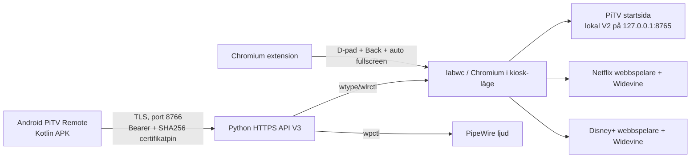

# Teknisk arkitektur

## Komponenter

**PiTV V2.4-komponenter:** `~/pi-tv/remote.py`, `start.sh`, `tv-home.html`, `phone-remote.html`, `dpad-extension/`, `remote-token`. HTTP-server 8765 behövs lokalt för startsidan och använder URL-nyckel. På nyinstallation begränsas den till `127.0.0.1` (historiskt var bindning 0.0.0.0).

**PiTV V3.0-komponenter:** `~/pi-tv-v3/server.py`, `api-token`, `tls-cert.pem`, `tls-key.pem`, `pitv-v3.service` och användar-sessionens labwc autostart. API: `GET /api/status` och `POST /api/action` på HTTPS/8766.

**PiTV V3.1:** installerar Chromium-tilläggets bakgrundsskript med `chrome.tabs.goBack()` och en kortkommandogenväg, samt byter `--start-fullscreen` till `--kiosk --start-maximized`.

**PiTV V3.2:** separat content script som söker upp större spelande videor på spelarliknande sökvägar. Försöker `requestFullscreen()` och lägger en lokal Chromium-policy för berörda domäner. Denna del är experimentell och kan sluta fungera när Netflix/Disney+ ändrar sin spelare.

## Integrationsgräns

Serverns HTTP 200 betyder **kommandot skickat**, inte att en TV-knapp verkligen fått fokus eller att videon startat. Android-appen använder TLS med certifikatpin (fingeravtryck från Pi) och nyckel i Authorization-header. Ingenting i projektet implementerar Google Cast-protokollet.

## Nätverk

Behov: mobil -> Pi TCP 8766; Pi -> Internet HTTPS för streaming; TV -> Pi via HDMI. Mobil och Pi behöver routing och rätt brandväggspolicy (om olika VLAN). V2/8765 ska inte öppnas för LAN efter migrering.
